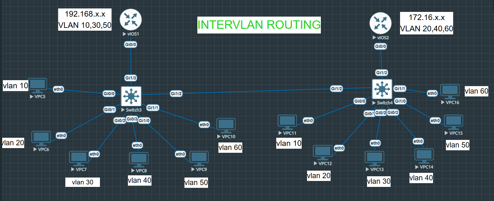
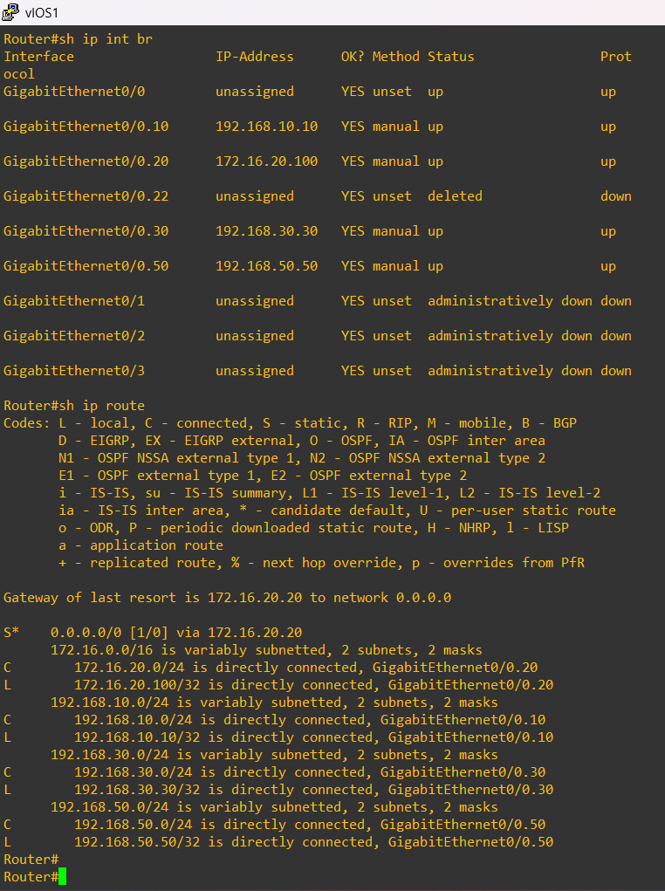
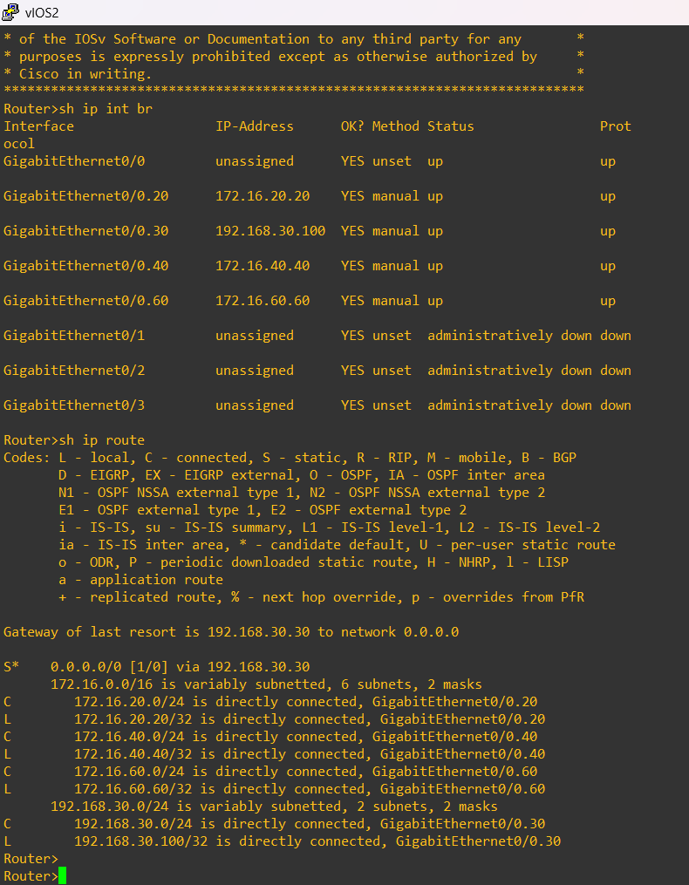
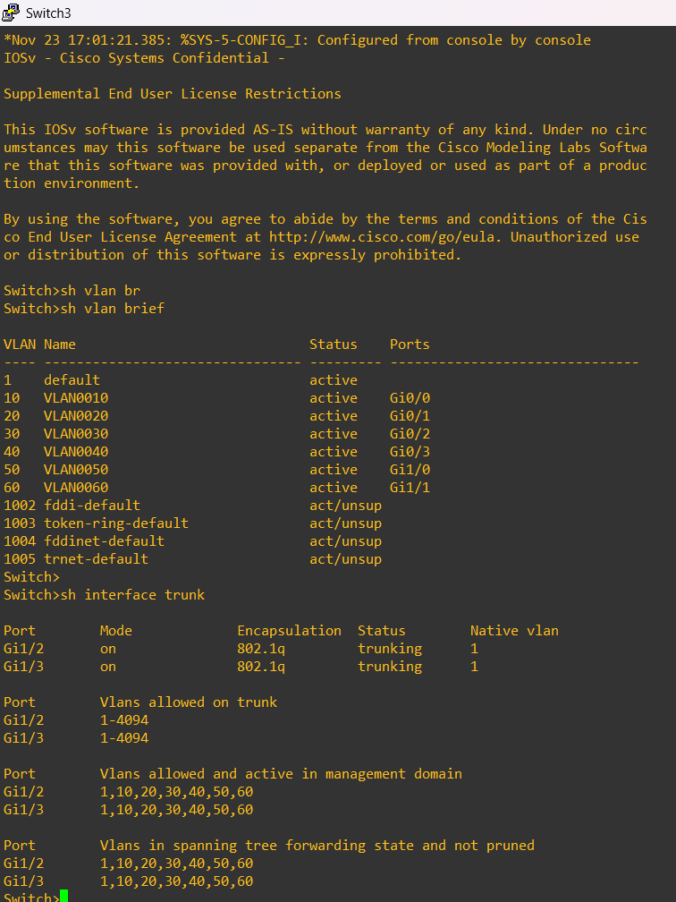
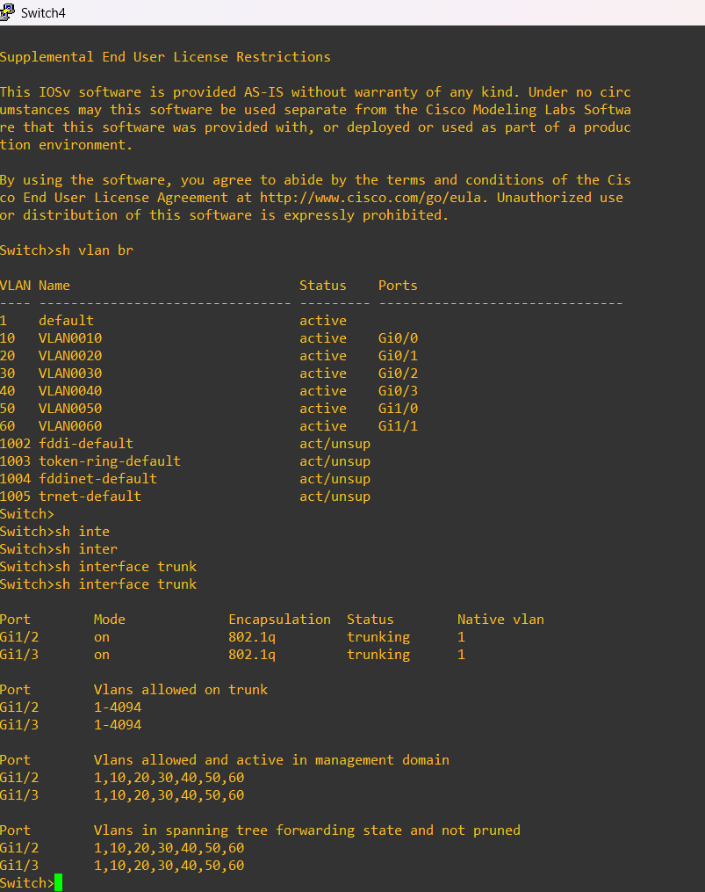
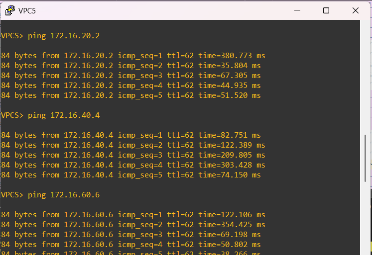
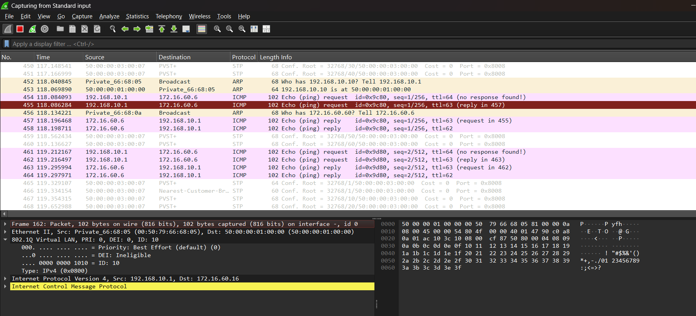

# Inter-VLAN Routing

## Project Overview
Implemented Inter-VLAN Routing using two routers and two Layer 2 switches in EVE-NG. Configured six VLANs and enabled communication between different VLANs using 802.1Q router subinterfaces.

## Network Topology

The topology contains 12 PCs distributed across six VLANs, connected through two switches and two routers.

### Topology Explanation
- Two Layer 2 switches connect 12 PCs across six VLANs.
- Trunk links carry multiple VLANs between network devices.
- Two routers use 802.1Q subinterfaces to provide inter-VLAN routing.
- Static routes enable communication between the networks connected to both routers.

## Configurations
- [Switch 1 Configuration](Configurations/Switch1.txt)
- [Switch 2 Configuration](Configurations/Switch2.txt)
- [Router 1 Configuration](Configurations/Router1.txt)
- [Router 2 Configuration](Configurations/Router2.txt)

## Technologies Used
- EVE-NG
- Cisco IOS
- VLANs and 802.1Q Trunking
- Router-on-a-Stick
- Wireshark

## Verification

### Router Verification

### Switch Verification

### Connectivity Testing

### Wireshark Analysis
